# DSO202 Practical 6 Report

## Creating a Helm Chart for a Complex Application on Kind

## 1. Objective

The aim of this practical was to create a Helm chart for a complex application and deploy it to Kubernetes.

The application is a three-tier visit counter:

| Tier     | Image                | Role                                       |
| -------- | -------------------- | ------------------------------------------ |
| Frontend | `nginx:1.30-alpine`  | Serves the page and forwards `/api/` calls |
| Backend  | `python:3.13-alpine` | API that counts visits                     |
| Database | `redis:7.4-alpine`   | Stores the count on a persistent volume    |

All three tiers are in one chart called `visitapp`. The same chart was installed for dev and prod using a different values file for each.

The practical also covered validation, testing, upgrade, rollback, packaging and Helm 4 drift detection.

The workflow used throughout the practical was:

```text
validate → install → verify → upgrade → roll back
```

## 2. Environment

| Item               | Value                                                   |
| ------------------ | ------------------------------------------------------- |
| Machine            | MacBook Air, Apple Silicon M4, arm64                    |
| Operating system   | macOS                                                   |
| Docker             | Docker Desktop 29.7.2                                   |
| kind               | v0.33.0                                                 |
| kubectl            | v1.37.1                                                 |
| Helm               | v4.3.0                                                  |
| Kubernetes         | v1.37.0                                                 |
| Cluster            | `dso202`, 1 control plane and 2 workers                 |
| Application images | `nginx:1.30-alpine`, `python:3.13-alpine`, `redis:7.4-alpine` |

## 3. Procedure and Observations

### Task 0: Pre Flight

The tools were checked and Helm reported `v4.3.0`.

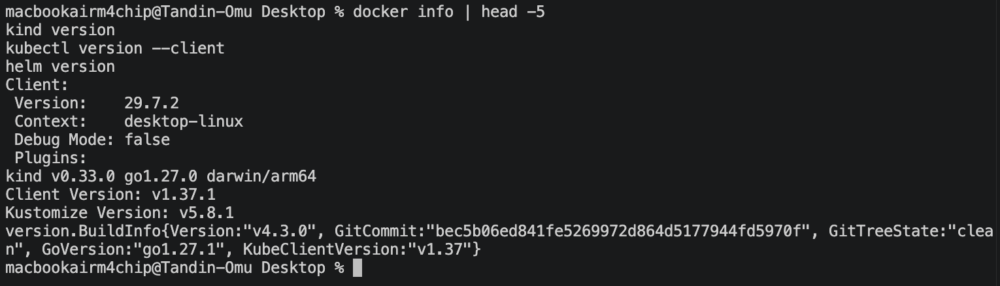

A three node Kind cluster was created using `cluster/kind-cluster.yaml`, which maps port 30080 to the host.

```bash
kind create cluster --config cluster/kind-cluster.yaml
```

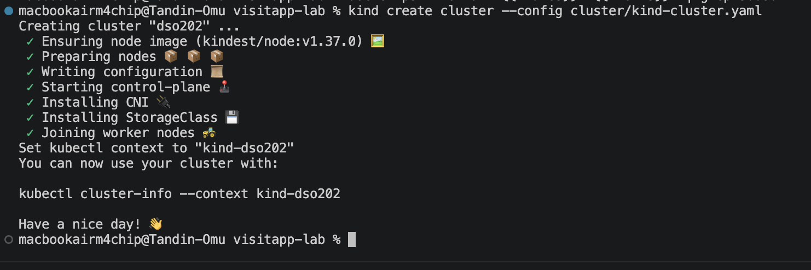

The context was `kind-dso202`, all three nodes were `Ready`, and the default StorageClass was `standard`.

### Task 1: The Chart

```text
visitapp-lab/
├── cluster/kind-cluster.yaml
├── environments/dev.yaml, prod.yaml
├── scripts/validate.sh
└── visitapp/
    ├── Chart.yaml
    ├── values.yaml
    ├── values.schema.json
    ├── files/app.py
    └── templates/
        ├── _helpers.tpl, NOTES.txt, ingress.yaml
        ├── frontend/   configmap, deployment, service
        ├── backend/    configmap, deployment, service, hpa
        ├── redis/      secret, service, statefulset
        └── tests/test-end-to-end.yaml
```

The environment files are outside the chart because they belong to the deployment, not the chart.

**Which values differ between dev and prod?**

| Setting      | Dev                       | Prod                  |
| ------------ | ------------------------- | --------------------- |
| Environment  | `dev`                     | `prod`                |
| Frontend     | 1 replica, NodePort 30080 | 2 replicas, ClusterIP |
| Backend      | 1 replica                 | 3 replicas            |
| Redis volume | 256Mi                     | 1Gi                   |

Redis uses a StatefulSet so that its Pod keeps the same name and the same volume after a restart.

### Task 2: Validation Errors

Two commands were run that should fail:

```bash
helm template visitapp-dev ./visitapp
helm template visitapp-dev ./visitapp -f environments/dev.yaml \
  --set backend.replicaCount=0 --set frontend.service.type=LoadBalancer
```

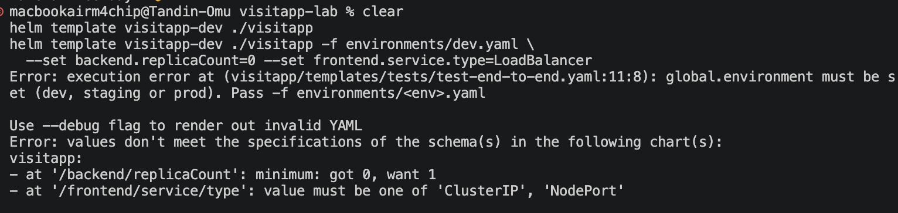

The first failed with `global.environment must be set`, from the `required` check. The second failed because of `values.schema.json`: replicas must be at least 1, and the Service type must be `ClusterIP` or `NodePort`.

### Task 3: Validate Before Installing

```bash
bash scripts/validate.sh
```

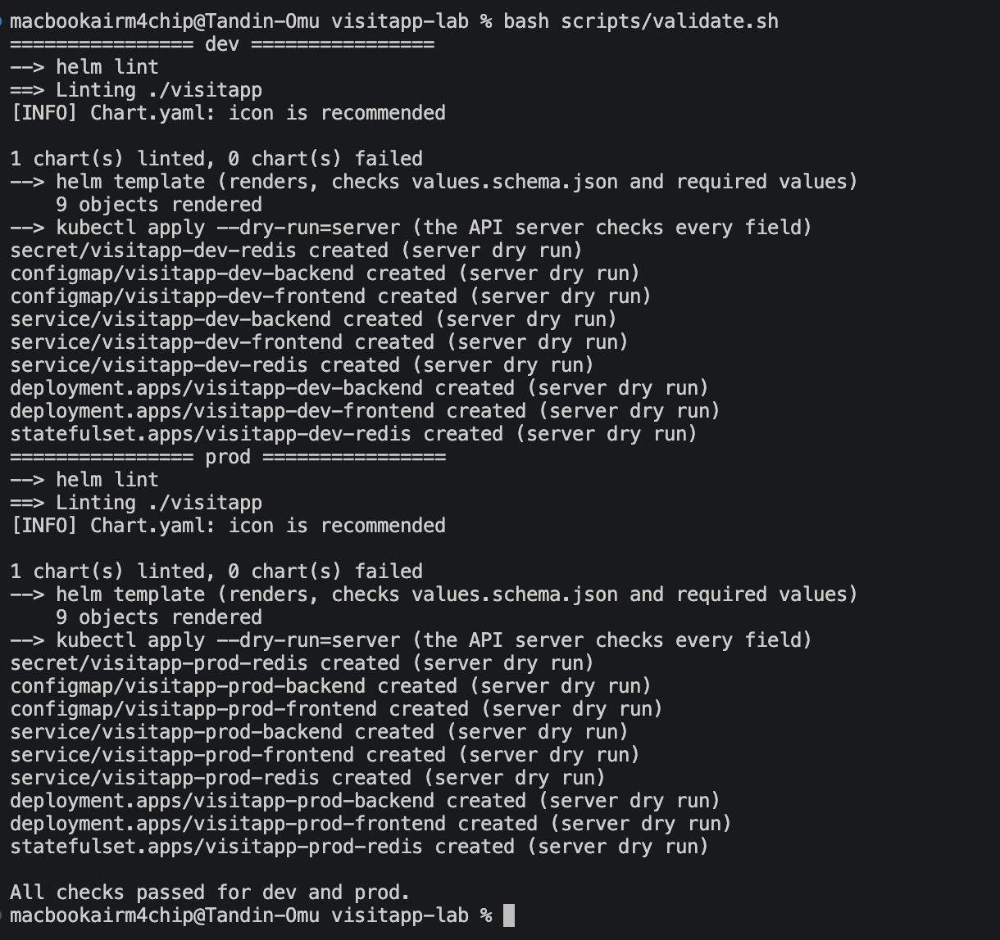

The script ran `helm lint`, `helm template` and `kubectl apply --dry-run=server` for dev and prod. Both rendered 9 objects and passed all checks.

### Task 4: Install Dev

```bash
helm upgrade --install visitapp-dev ./visitapp -f environments/dev.yaml \
  -n dso202-dev --create-namespace --wait --timeout 5m
```

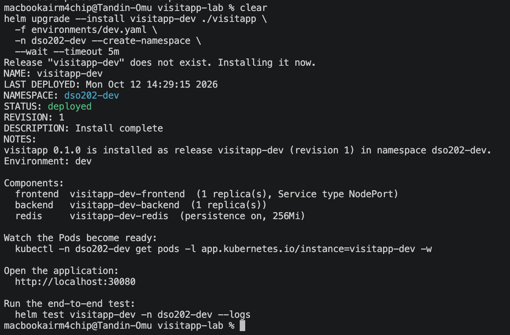

The release was installed with `STATUS: deployed` and `REVISION: 1`.

```bash
kubectl get all,pvc -n dso202-dev
```

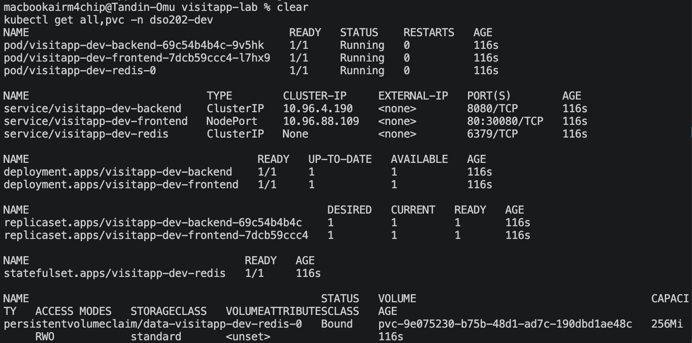

Three Pods were running: frontend, backend and `redis-0`. The frontend Service was `NodePort 80:30080`, and the PVC `data-visitapp-dev-redis-0` was `Bound` with 256Mi.

### Task 5: Reach the Application

`http://localhost:30080` returned `400 Request Header Or Cookie Too Large` because the browser sent cookies from other localhost projects. `http://127.0.0.1:30080` was used instead.

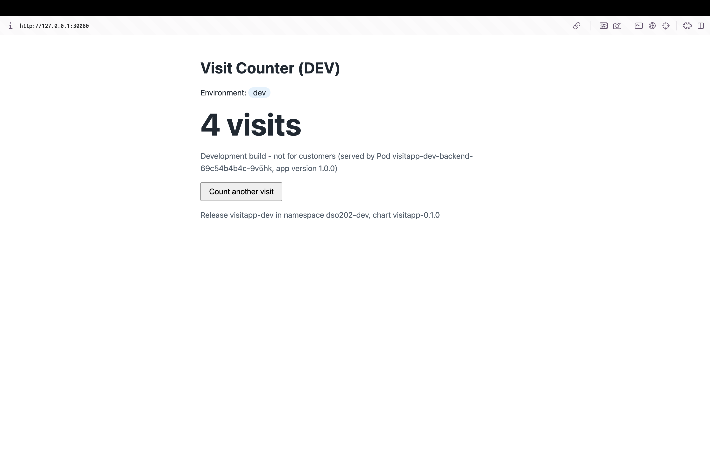

The page showed "Visit Counter (DEV)", the visit count, and the backend Pod that answered.

```bash
curl -s -X POST http://localhost:30080/api/visit
curl -s http://localhost:30080/api/stats
```

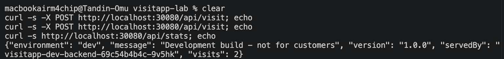

Each POST increased the count by 1 (6, then 7), and GET read it back without changing it.

### Task 6: Helm Test

```bash
helm test visitapp-dev -n dso202-dev --logs
```

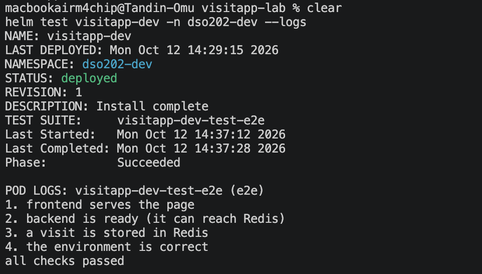

The test checked all three tiers and finished with `Phase: Succeeded` and `all checks passed`.

### Task 7: Inspect the Release

```bash
helm list -n dso202-dev
helm get values visitapp-dev -n dso202-dev
kubectl get secret -n dso202-dev -l owner=helm
```

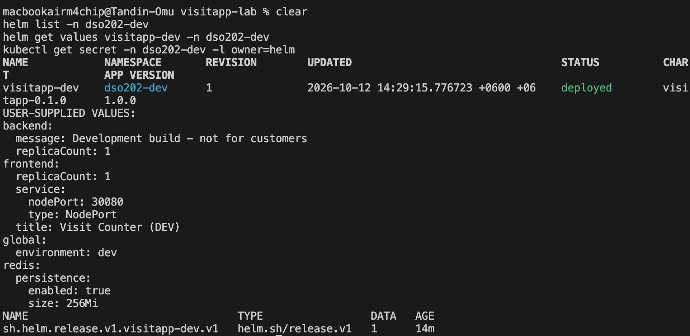

`helm get values` showed the values from `dev.yaml`. Helm stored revision 1 as the Secret `sh.helm.release.v1.visitapp-dev.v1`.

### Task 8: Upgrade

The backend message in `dev.yaml` was changed to `Upgraded by Helm - revision 2`, and the release was upgraded.

```bash
helm upgrade visitapp-dev ./visitapp -f environments/dev.yaml -n dso202-dev --wait
```

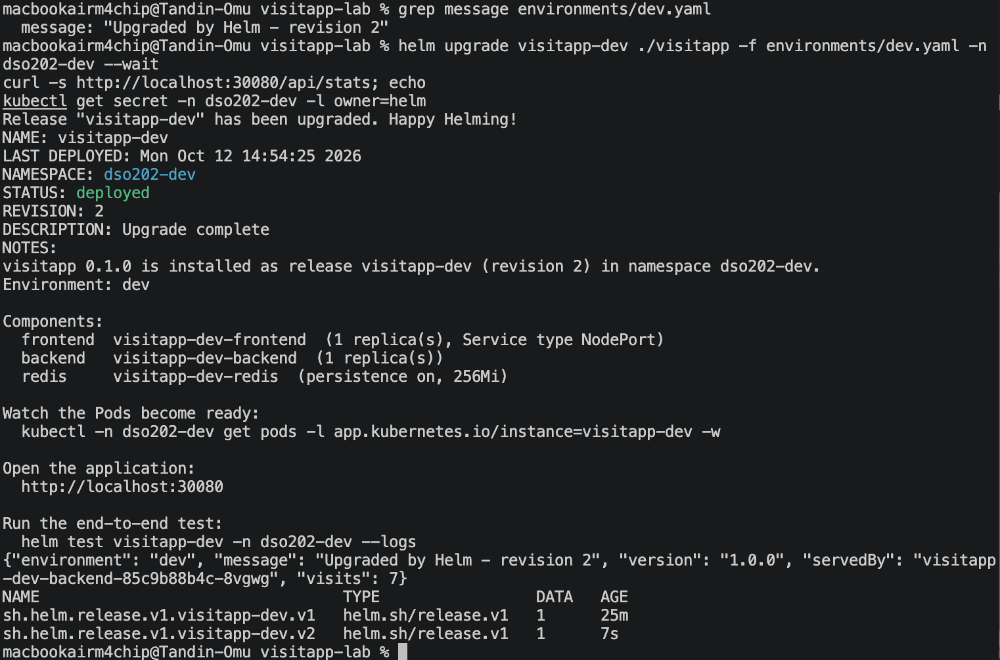

| Item        | Before                                  | After                           |
| ----------- | --------------------------------------- | ------------------------------- |
| Revision    | 1                                       | 2                               |
| Message     | `Development build - not for customers` | `Upgraded by Helm - revision 2` |
| Backend Pod | `...-69c54b4b4c-9v5hk`                  | `...-85c9b88b4c-8vgwg`          |
| Visits      | 7                                       | 7                               |

The backend Pod was replaced, but the visit count stayed the same because Redis was not changed.

### Task 9: Scale the Backend

The backend `replicaCount` in `dev.yaml` was changed from 1 to 3 and the release was upgraded to revision 3.

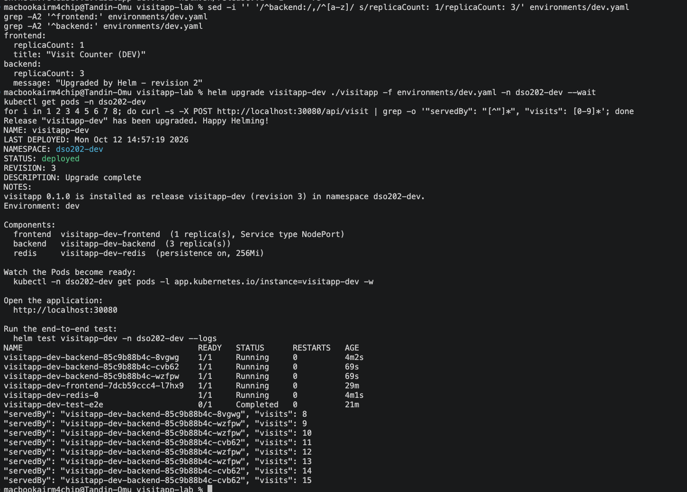

Eight requests were answered by all three backend Pods, and the count increased from 8 to 15 without skipping. All backends share one Redis database.

### Task 10: Persistence

```bash
kubectl delete pod visitapp-dev-redis-0 -n dso202-dev
```

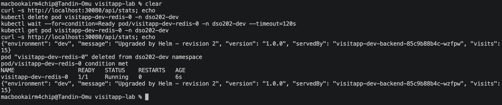

The count was 15 before and after deleting the Redis Pod. The StatefulSet created a new `redis-0` and attached the same PVC.

### Task 11: Rollback

```bash
helm rollback visitapp-dev 1 -n dso202-dev --wait
helm history visitapp-dev -n dso202-dev
```

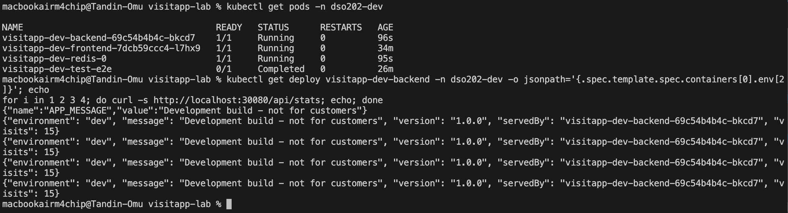

The rollback created revision 4 with the description `Rollback to 1`. The backend went back to 1 replica and the original message.

The new Pod hash `69c54b4b4c` matched the first Pod from Task 4, so revision 1's configuration was restored exactly.

The visit count stayed at 15. Rollback restores manifests, not data.

### Task 12: Values-Loss Trap

```bash
helm upgrade visitapp-dev ./visitapp -n dso202-dev --set backend.replicaCount=2
```

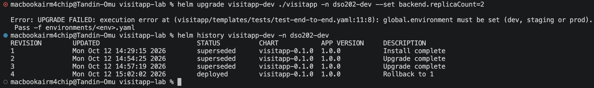

Using `--set` without the values file drops all earlier values. The upgrade failed with `global.environment must be set`, and the history stayed at revision 4.

### Task 13: Deploy Prod

```bash
helm upgrade --install visitapp-prod ./visitapp -f environments/prod.yaml \
  -n dso202-prod --create-namespace --rollback-on-failure --timeout 5m
```

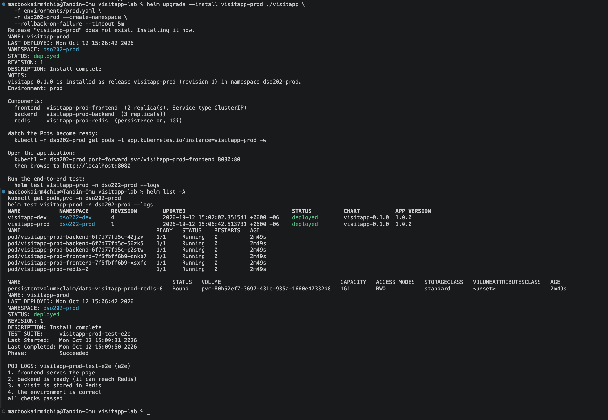

Prod ran 2 frontend Pods, 3 backend Pods and Redis with a 1Gi volume. `helm test` also passed for prod.

The prod frontend is ClusterIP, so it was opened using port forwarding on port 8081.

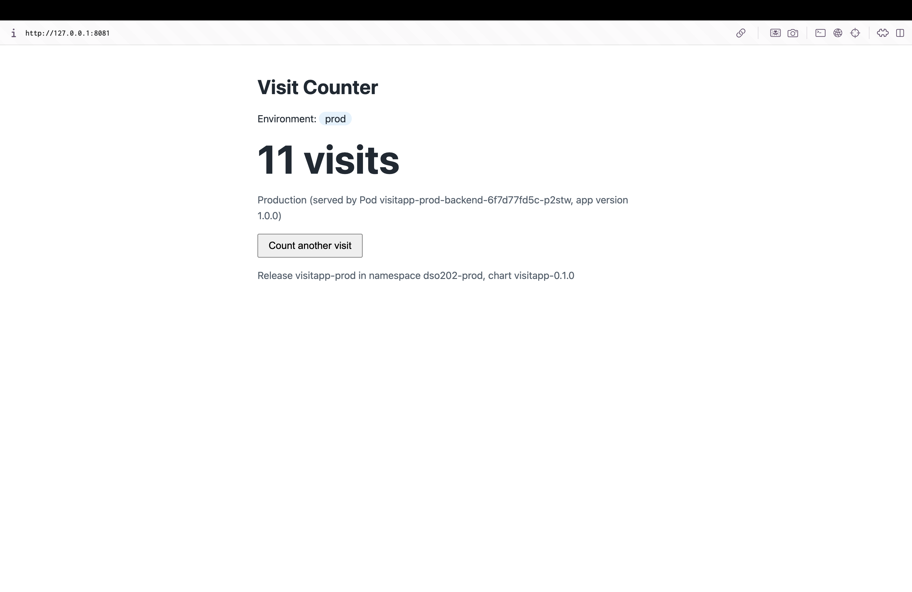

Prod showed its own environment, message and visit count, separate from dev.

### Task 14: Package the Chart

```bash
helm package ./visitapp
```

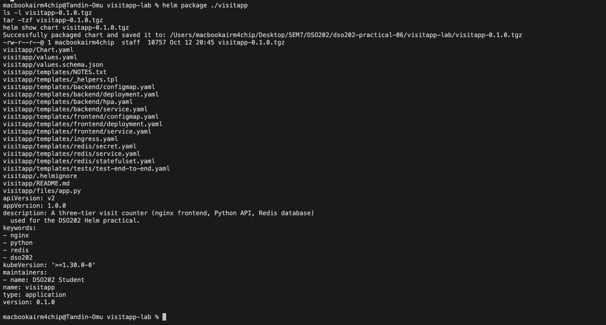

The chart was packaged as `visitapp-0.1.0.tgz`. The `environments/` files were not included because they are not part of the chart.

### Task 15: Uninstall

```bash
helm uninstall visitapp-dev -n dso202-dev
helm uninstall visitapp-prod -n dso202-prod
```

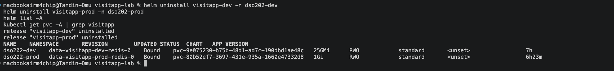

Both releases were removed, but both PVCs remained. They were created by the StatefulSet, not by Helm, so Helm does not delete them.

## Extension 1: Reinstall Keeps the Data

The dev release was installed again before deleting the PVCs.

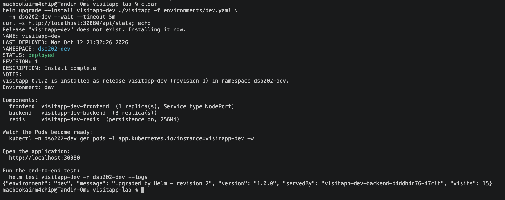

The count was still 15 because Redis attached the old PVC. The release history started again at revision 1.

## Extension 2: Helm 4 Drift Detection

The backend was scaled with `kubectl`, outside Helm, and then Helm was upgraded.

```bash
kubectl scale deployment visitapp-dev-backend -n dso202-dev --replicas=2
helm upgrade visitapp-dev ./visitapp -f environments/dev.yaml -n dso202-dev --wait
```

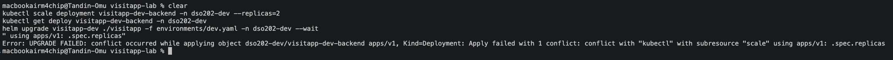

The upgrade failed with a conflict on `.spec.replicas` owned by `kubectl`. Helm 4 does not silently overwrite changes made by other tools.

```bash
helm upgrade visitapp-dev ./visitapp -f environments/dev.yaml -n dso202-dev --wait --force-conflicts
```

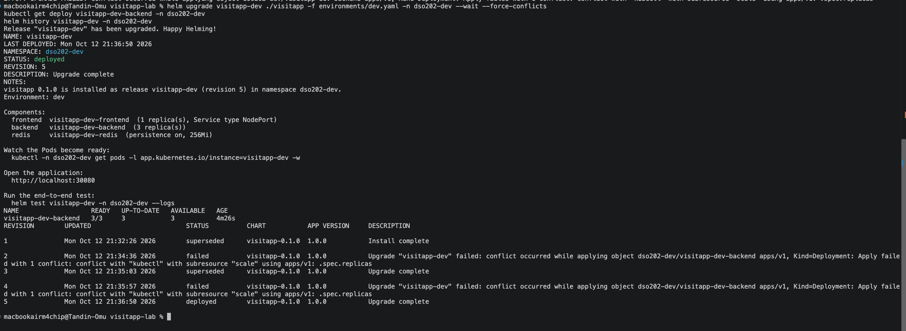

`--force-conflicts` gave the field back to Helm and the backend returned to 3 replicas. The failed attempts were recorded as `failed` revisions in the history.

### Final Cleanup

```bash
helm uninstall visitapp-dev -n dso202-dev
kubectl delete pvc --all -n dso202-dev
kubectl delete pvc --all -n dso202-prod
kubectl delete namespace dso202-dev dso202-prod
```

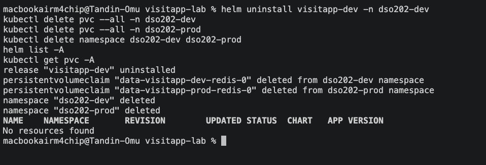

No releases or PVCs remained.

## 4. Helm and Kustomize

|               | Kustomize                  | Helm                          |
| ------------- | -------------------------- | ----------------------------- |
| Method        | Base and overlays          | Templates and values          |
| Environments  | Overlay folders            | Values files                  |
| Input check   | None                       | `required` and schema         |
| History       | None                       | Revisions stored as Secrets   |
| Rollback      | Re-apply from Git          | `helm rollback`               |
| Packaging     | No                         | `.tgz` package                |

Kustomize is simpler for small changes. Helm is better for packaging a whole application with versions, tests and rollback.

## 5. Reflection

One problem occurred in Task 5. The browser showed `400 Request Header Or Cookie Too Large` because of old localhost cookies. Using `127.0.0.1` fixed it.

Another problem occurred in Task 11. The first `curl` after the rollback still showed the new message because an old Pod was still shutting down. Checking again after 30 seconds showed the correct result.

This showed the importance of checking the actual output instead of assuming that a command worked.

One point that remains unclear is when an application should be split into several charts using dependencies instead of one chart.